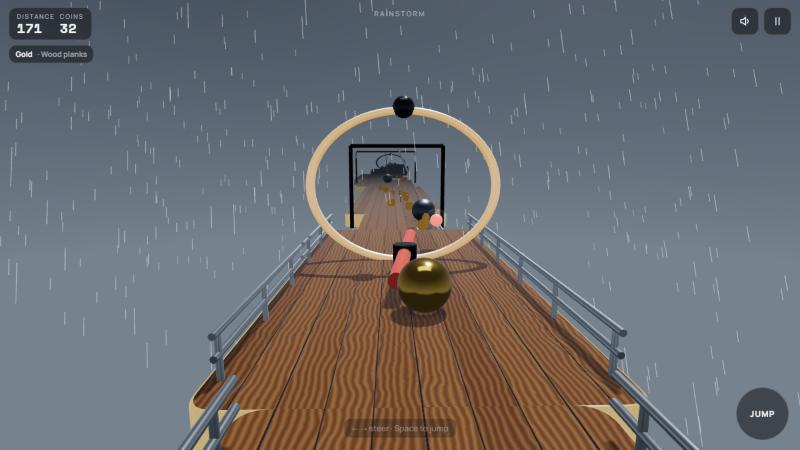
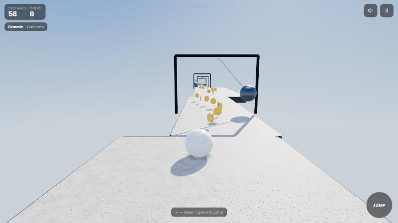
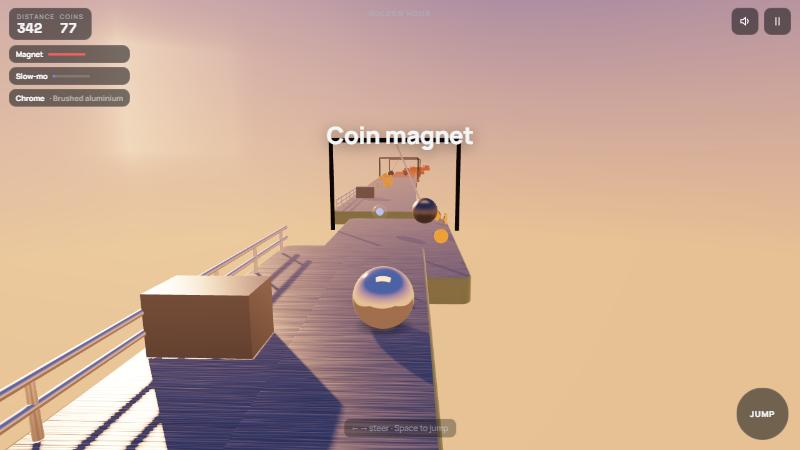
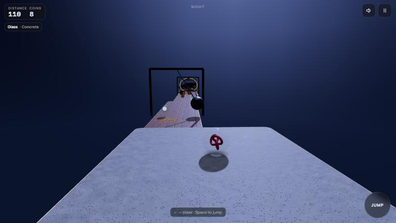
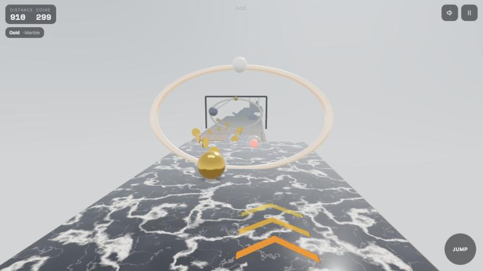
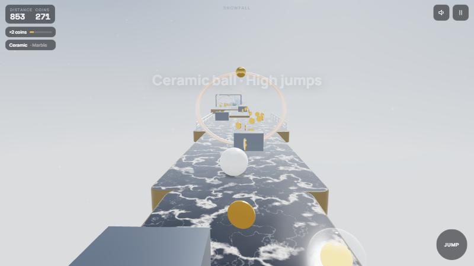
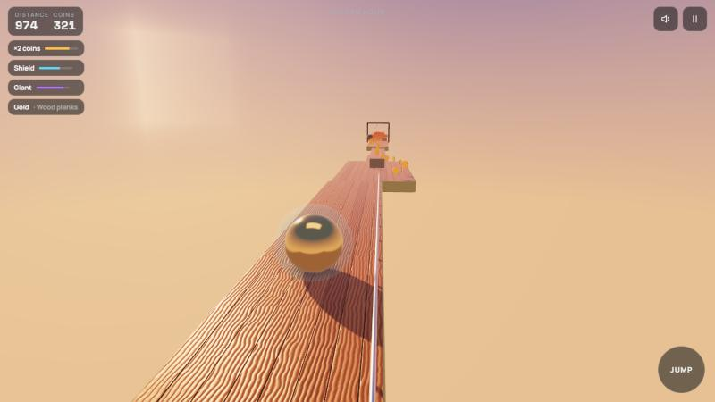

# Momentum

A ball-rolling track game by **Obi Promise** (CSC 131). *Working title.*

**Play:** https://obipromise.github.io/momentum-ball/ (best on a phone held sideways)

Roll a ball along a track floating in the sky for as long as you can. The track changes its surface as you go, the weather never stops changing, and the ball itself can change too.

## What changes as you play
- **Surfaces** change every zone: concrete, marble, wood planks, black acrylic, light oak and brushed aluminium. Each has realistic texture and shine, and its own rolling sound.
- **Weather** cycles constantly: clear day, golden hour, night (the track edges glow), rainstorm (lightning, and the surface turns wet and glossy), fog and snowfall. Reflections on the ball follow the sky.
- **Ball skins** swap when you roll through a gate, and each has its own trait:

| Skin | Trait |
|---|---|
| Chrome | Mirror finish |
| Rubber | Extra grip |
| Gold | Coins worth 2 |
| Glass | Floaty jumps |
| Carbon | +12% speed |
| Ceramic | High jumps |

## Things you can hit
| | Effect |
|---|---|
| Coins | Score |
| ×2 orb | Coins count double for 12 seconds |
| Magnet orb | Pulls coins toward you |
| Shield orb | Blocks one hit, or saves you from one fall |
| Giant orb | Huge ball that smashes through obstacles |
| Slow-mo orb | Slows time down |
| Orange pads | Speed boost |
| Jump pads | Launch you across wide gaps |
| Pushers, spinners, pendulums, bollards | Knock you around, and maybe off the edge |

Some sections have guard rails; the narrow bridges never do.

## Controls
| | Phone | Keyboard |
|---|---|---|
| Steer | Tilt, or hold the left/right side of the screen | ← → or A / D |
| Jump | JUMP button | Space or ↑ |

## Scenes
| | | |
|---|---|---|
|  |  |  |
|  |  |  |

## How it works
One HTML file using JavaScript and Three.js.
- **Materials:** every surface is generated in code. A single height field produces matching colour, normal (surface bump) and roughness maps, which tile seamlessly. Rendering uses physically based materials with clear coat.
- **Weather:** a shader draws the sky dome. Fog, light and exposure blend between weather states, and the reflection map is re-captured from the sky as it changes.
- **Rolling:** the ball turns about the axis perpendicular to its motion, by distance divided by radius, so it looks like it truly rolls rather than slides.
- **Track:** sections stream in ahead and are removed behind, at different widths, with sideways offsets, drops and gaps.
- **Physics:** a fixed 120 Hz step for the physics, a 60 fps render cap, and a "Fast" graphics mode for phones.

`design/` holds the concept and material studies used to choose the look.
